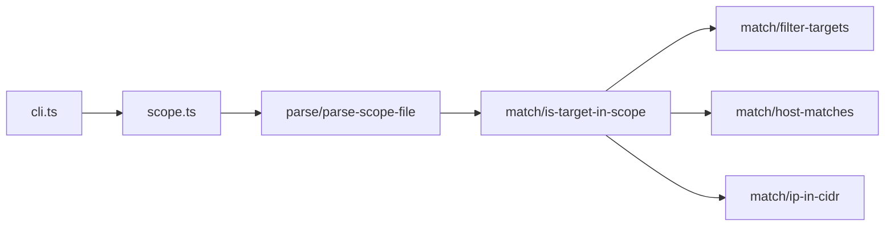

# hx-scope-enforcer-cli — architecture

## Purpose

Parses engagement scope definition files (hosts, wildcards, CIDRs), normalizes targets
from URLs or bare hostnames, and answers whether each target is in scope. Non-goals:
storing engagement metadata, rate limits, or automatic program rule download from
bug-bounty platforms.

## High-level flow

## Module map

| Path                              | Responsibility                                                              |
| --------------------------------- | --------------------------------------------------------------------------- |
| `src/cli.ts`                      | `init`, `validate`, `check`, `filter` commands                              |
| `src/index.ts`                    | Package entry                                                               |
| `src/scope.ts`                    | Facade: `parseScopeFile`, `isTargetInScope`, `filterTargets`, example scope |
| `src/types.ts`                    | Scope entry and check result types                                          |
| `src/constants/example-scope.ts`  | `EXAMPLE_SCOPE` template for `init`                                         |
| `src/parse/parse-scope-file.ts`   | Full file parse with error collection                                       |
| `src/parse/parse-scope-line.ts`   | Single line → scope entry                                                   |
| `src/parse/regex.ts`              | Line pattern helpers                                                        |
| `src/match/normalize-target.ts`   | URL/host/IP normalization                                                   |
| `src/match/is-target-in-scope.ts` | Single target evaluation                                                    |
| `src/match/filter-targets.ts`     | Partition target list                                                       |
| `src/match/host-matches.ts`       | Hostname and wildcard matching                                              |
| `src/match/ip-in-cidr.ts`         | CIDR membership via `ipaddr.js`                                             |
| `src/reporters/json.ts`           | JSON helpers (used by tests/library)                                        |

## Extension

1. Extend `parse-scope-line.ts` for new scope line types.
2. Add matching logic in `match/` and wire through `is-target-in-scope.ts`.
3. Unit-test with fixture scope files — no network.
4. Run `npm test` and `npm run format:check`.

## Testing strategy

- **Unit**: `*.spec.ts` under `parse/` and `match/` — pure parsing and matching.
- **Integration**: `jest.integration.config.js` — optional end-to-end CLI fixtures.

## Ethics & scope

Authorized engagements only. See [SECURITY.md](./SECURITY.md).
